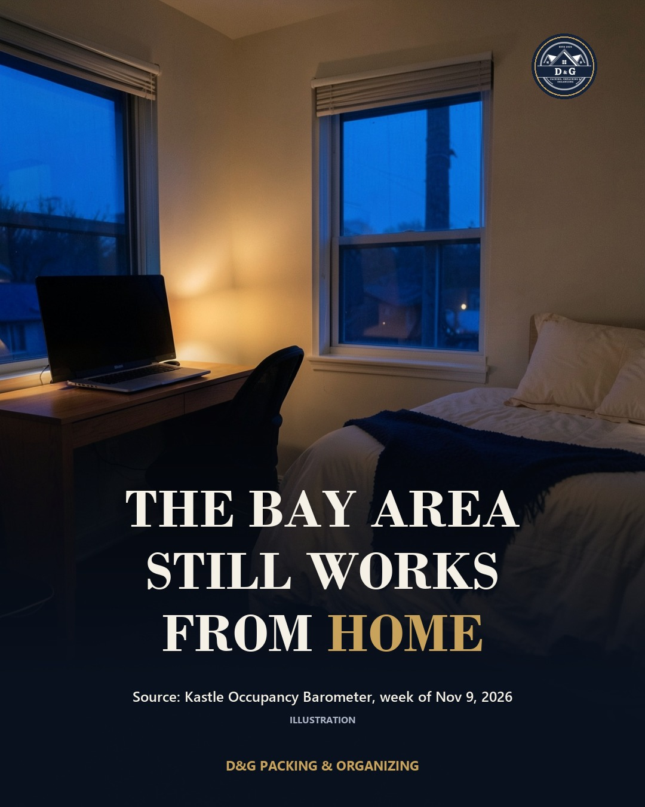
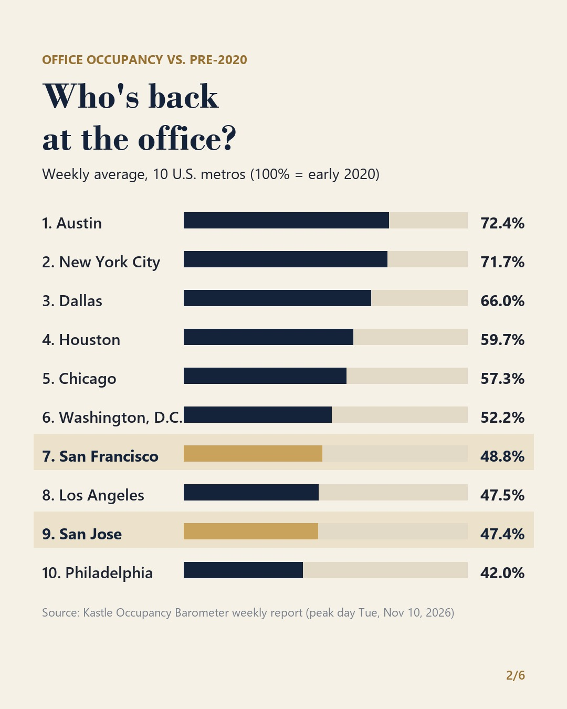
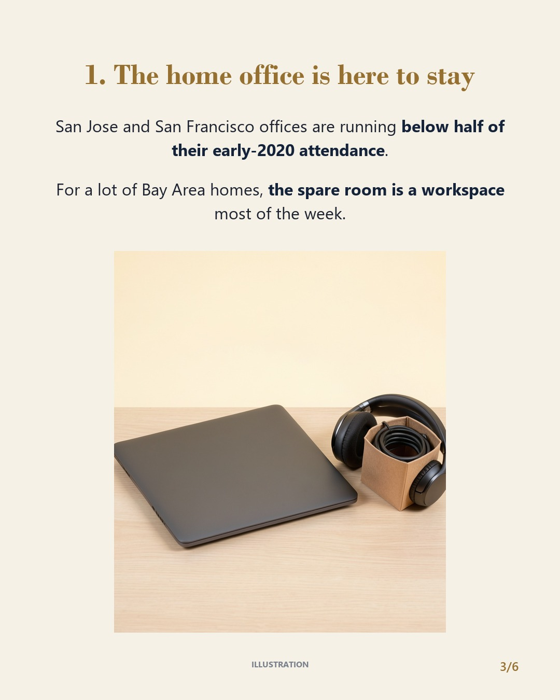
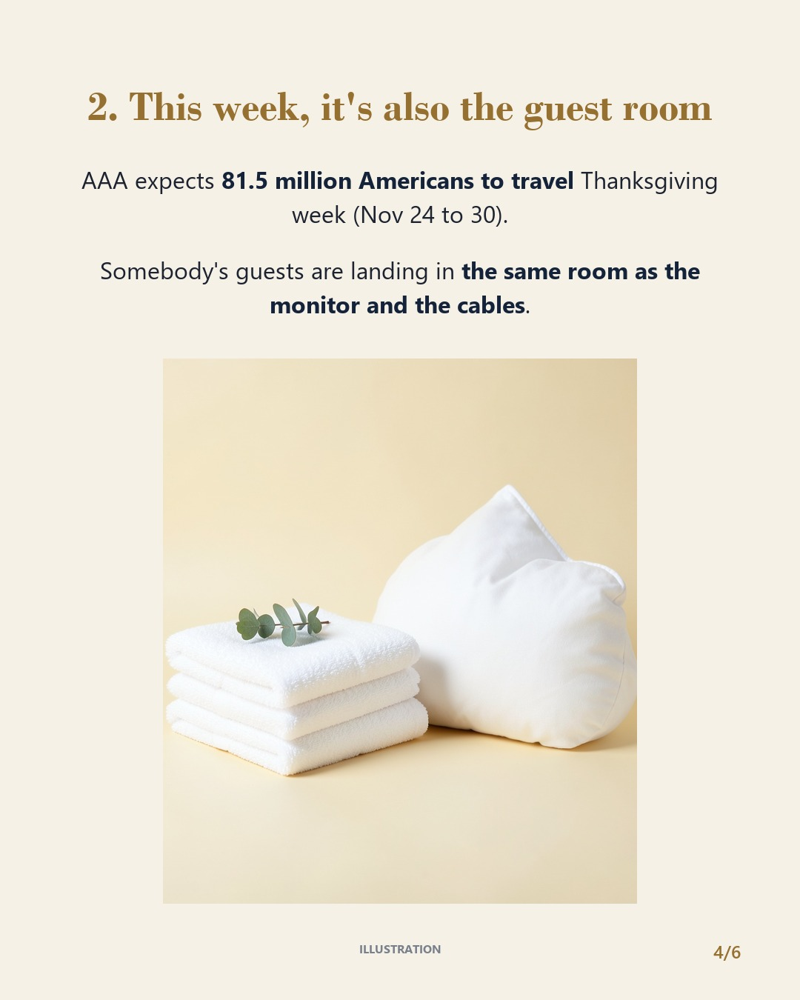
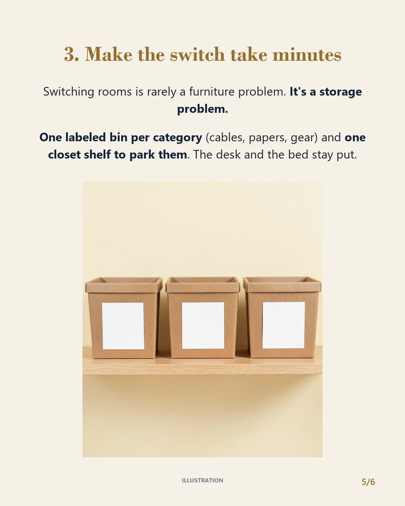
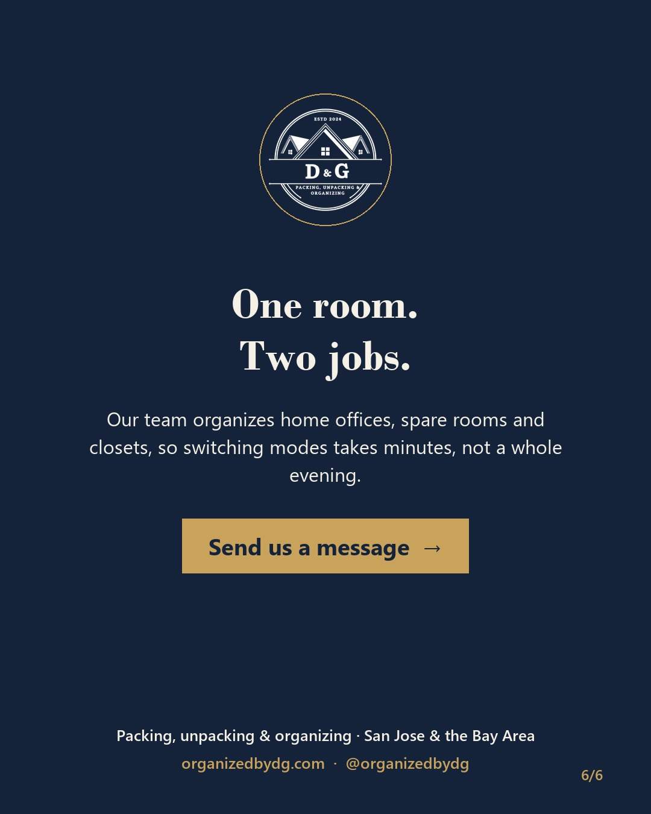

# LinkedIn gallery: The Bay Area still works from home

**When:** Tonight, Mon Nov 23, 6 p.m. PT, on the D&G Packing and Organizing Company page.

**Post only after version 4 is approved in the CRM.**

## How to post from your phone
1. Long-press each image below and save it to your photos (1 to 6, in order).
2. In the LinkedIn app, switch to the D&G company page, tap **Post**, then the photo icon, and pick the 6 images in order.
3. Copy the caption below and paste it as the post text, then post.

## Images (in order)

**1 of 6**



**2 of 6**



**3 of 6**



**4 of 6**



**5 of 6**



**6 of 6**



## Caption (copy all of it)

```
The Bay Area still works from home. The data says so.

In Kastle's latest weekly office report, San Francisco ranked 7th and San Jose 9th of 10 U.S. metros for office attendance: both under half of their early-2020 levels. Austin and New York were above 70%.

So in a lot of Bay Area homes, the spare room has a second job. Most weeks it's the office. And this week, with AAA expecting 81.5 million Americans on the road for Thanksgiving, it's also the guest room.

Switching that room from work mode to guest mode is rarely a furniture problem. It's a storage problem: cables, papers and gear with no assigned home.

The fix is a small system: one labeled bin per category, one closet shelf to park them, and the desk and the bed stay where they are. Bins go up for guests and come back down Monday.

Our team organizes home offices, spare rooms and closets across San Jose and the Bay Area. If your home office has quietly become the storage room, send us a message.

#HybridWork #HomeOrganizing #BayArea
```
