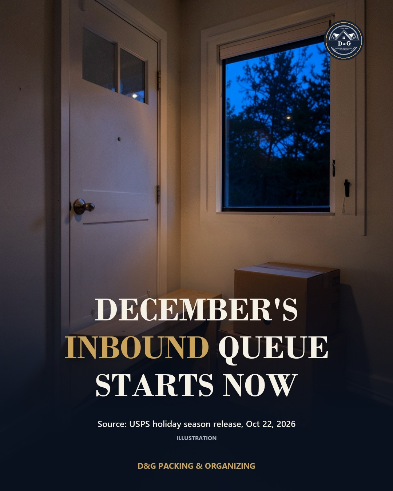
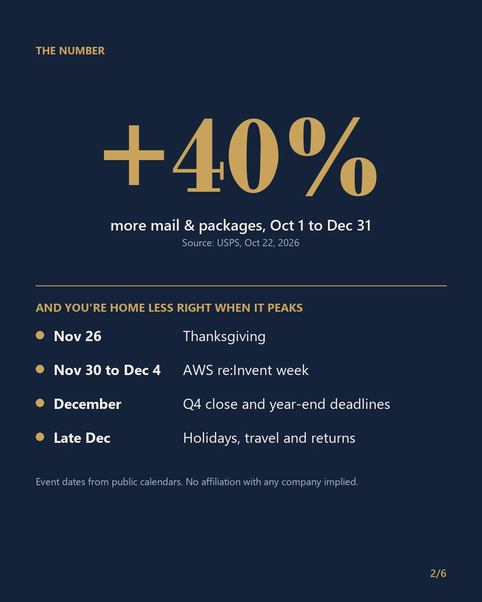
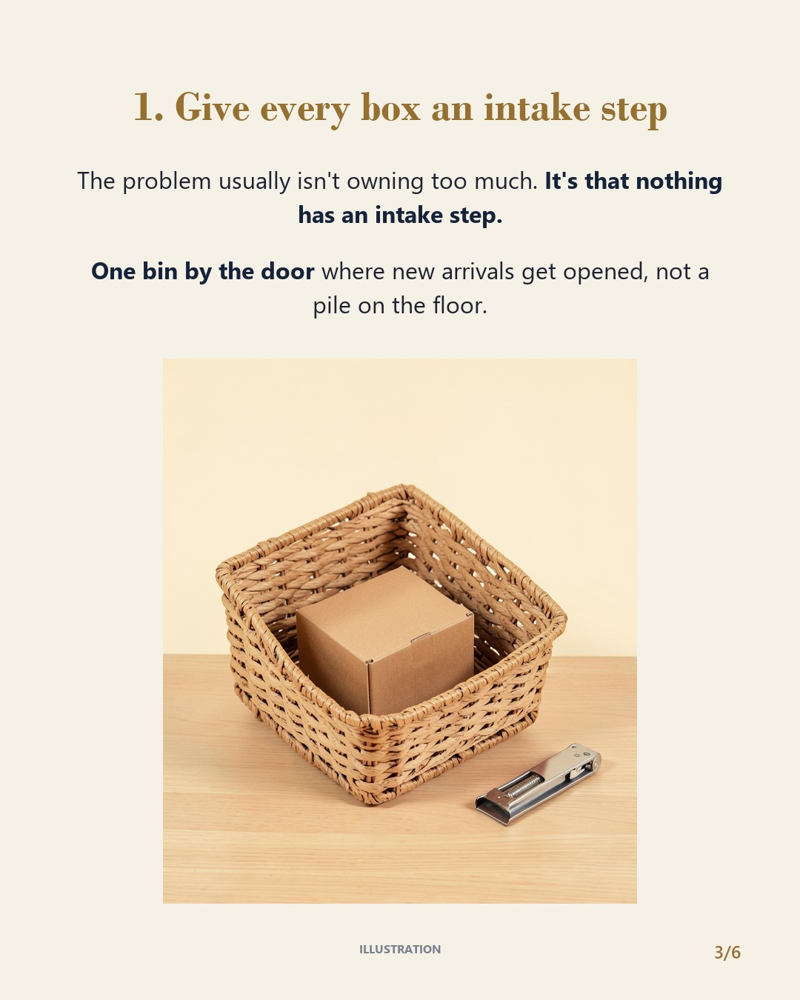
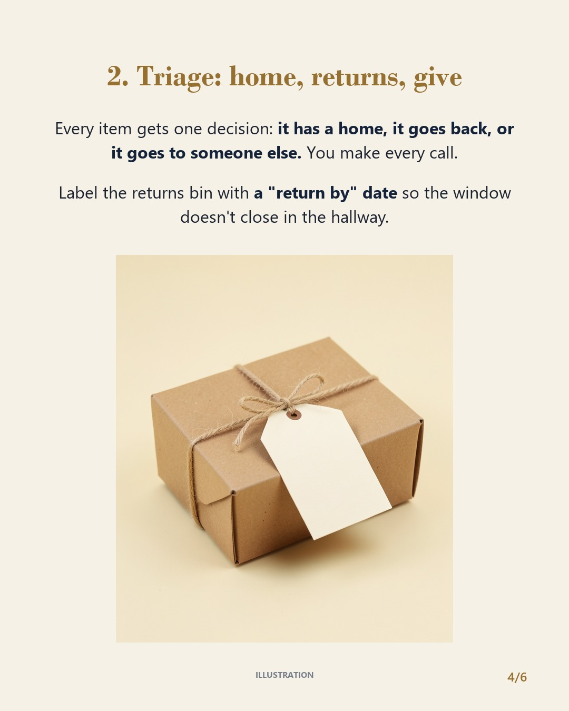
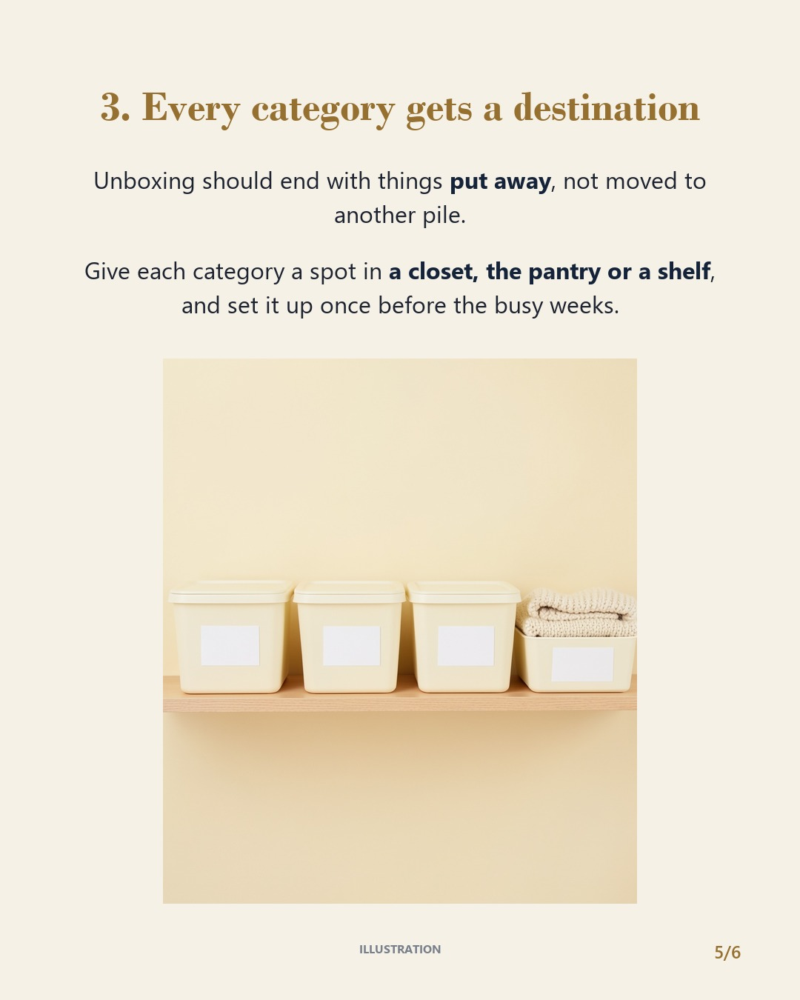
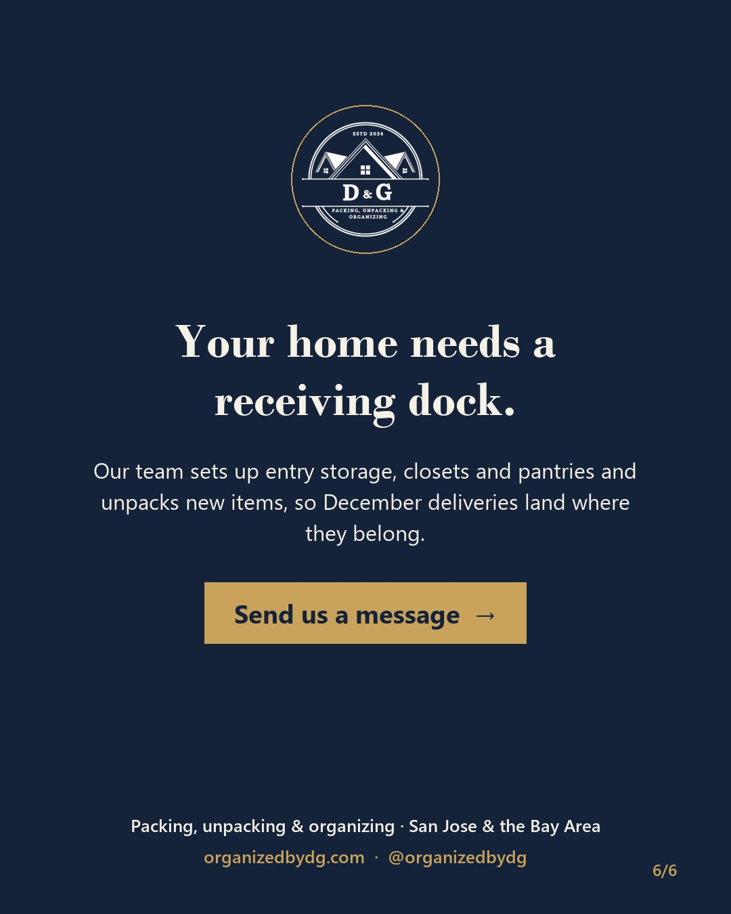

# LinkedIn gallery: December's inbound queue starts now

**When:** Tue Nov 24, 6 p.m. PT, on the D&G Packing and Organizing Company page.

**Post only after version 4 is approved in the CRM.**

## How to post from your phone
1. Long-press each image below and save it to your photos (1 to 6, in order).
2. In the LinkedIn app, switch to the D&G company page, tap **Post**, then the photo icon, and pick the 6 images in order.
3. Copy the caption below and paste it as the post text, then post.

## Images (in order)

**1 of 6**



**2 of 6**



**3 of 6**



**4 of 6**



**5 of 6**



**6 of 6**



## Caption (copy all of it)

```
December's inbound queue starts now.

USPS expects mail and package volume to rise about 40% between October 1 and December 31. Your entryway feels it first.

And for a lot of Bay Area tech folks, the peak lands right when you're home least: Thanksgiving, conference season (re:Invent runs Nov 30 to Dec 4), the Q4 close and holiday travel.

The problem usually isn't owning too much. It's that nothing has an intake step. Boxes pile up by the door, and the return window closes while the box is still in the hallway.

Treat December deliveries like a pipeline: one intake bin by the door, a quick triage (home, returns with a "return by" date, or give, and you decide), and a destination for every category in a closet, pantry or shelf.

Our team sets up entry storage, closets and pantries and unpacks new items across San Jose and the Bay Area. Want a simple receiving zone before December gets busy? Send us a message.

#Productivity #HomeOrganizing #BayArea
```
